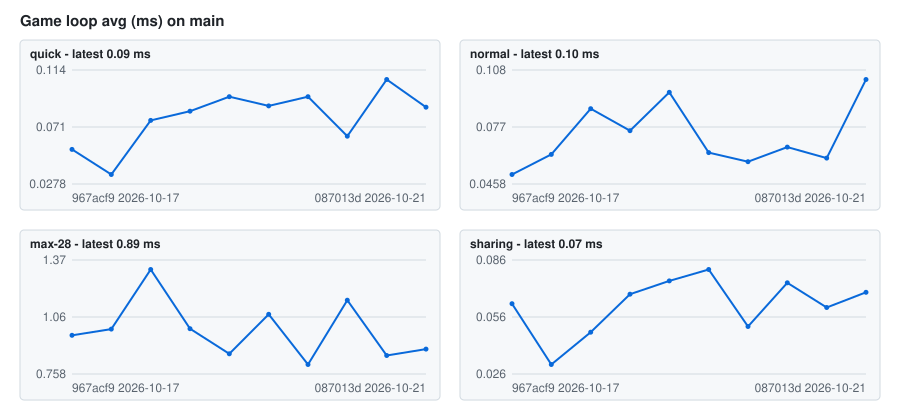
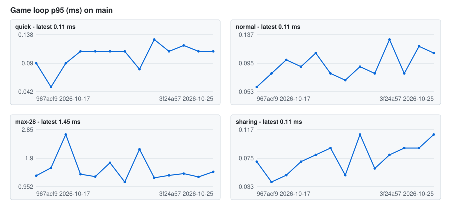
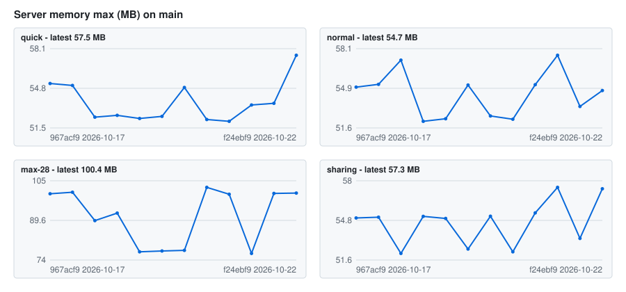
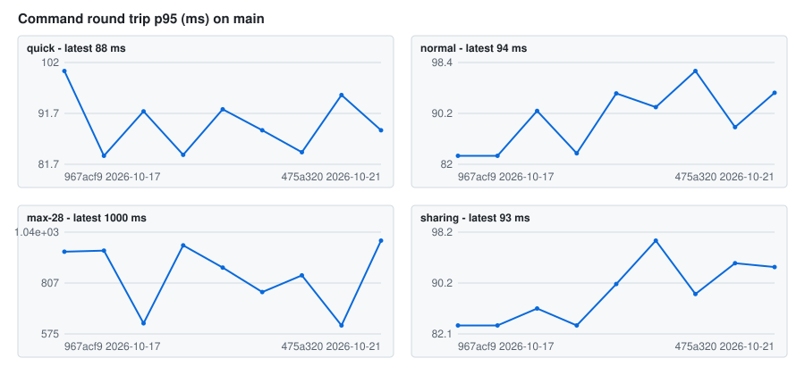

# Full test performance on main

Written by the *Performance history* workflow after every full test run on `main` (`utils/debug_harness/perf_history.py`). Raw data: [history.json](history.json).

## quick

| Commit | Date | Result | Game loop avg | Game loop p95 | Server memory max | Command round trip p95 | Vehicles (max) |
|---|---|---|---|---|---|---|---|
| [`6926091`](https://github.com/shoter/SJGRPP/commit/69260912eee77f47ee0467606da79344e8d0e8fc) | 2026-10-21 | ✅ [run](https://github.com/shoter/SJGRPP/actions/runs/39573199057) | 0.06 ms | 0.08 ms | 52.2 MB | 95 ms | 40 |
| [`6043884`](https://github.com/shoter/SJGRPP/commit/6043884a61c1f57e6d32ec368592e45fd488e0f4) | 2026-10-21 | ✅ [run](https://github.com/shoter/SJGRPP/actions/runs/39518779315) | 0.09 ms | 0.11 ms | 54.9 MB | 84 ms | 40 |
| [`630dd28`](https://github.com/shoter/SJGRPP/commit/630dd281109396e981208c0ad6a9629183cb209c) | 2026-10-20 | ✅ [run](https://github.com/shoter/SJGRPP/actions/runs/39510963484) | 0.09 ms | 0.11 ms | 52.5 MB | 88 ms | 40 |
| [`149357f`](https://github.com/shoter/SJGRPP/commit/149357f901dd49e598672f4356725aa29337d46f) | 2026-10-20 | ✅ [run](https://github.com/shoter/SJGRPP/actions/runs/39498396618) | 0.09 ms | 0.11 ms | 52.3 MB | 92 ms | 40 |
| [`f105be1`](https://github.com/shoter/SJGRPP/commit/f105be163c06e5e2612ac405c6d0390d2cee3868) | 2026-10-20 | ✅ [run](https://github.com/shoter/SJGRPP/actions/runs/39476068981) | 0.08 ms | 0.11 ms | 52.5 MB | 84 ms | 40 |
| [`0e597f3`](https://github.com/shoter/SJGRPP/commit/0e597f3a885b72efac6c96225930b6fd5b0e0ce3) | 2026-10-20 | ✅ [run](https://github.com/shoter/SJGRPP/actions/runs/39413250699) | 0.08 ms | 0.09 ms | 52.4 MB | 92 ms | 40 |
| [`52efdca`](https://github.com/shoter/SJGRPP/commit/52efdcaf846d7b37e80a977422e3a96bf3c6b3e0) | 2026-10-17 | ✅ [run](https://github.com/shoter/SJGRPP/actions/runs/38996750480) | 0.04 ms | 0.05 ms | 55.0 MB | 83 ms | 31 |
| [`967acf9`](https://github.com/shoter/SJGRPP/commit/967acf9f722fe74c84a7a550aef3b276acef8032) | 2026-10-17 | ✅ [run](https://github.com/shoter/SJGRPP/actions/runs/38993951271) | 0.05 ms | 0.09 ms | 55.2 MB | 100 ms | 31 |

## normal

| Commit | Date | Result | Game loop avg | Game loop p95 | Server memory max | Command round trip p95 | Vehicles (max) |
|---|---|---|---|---|---|---|---|
| [`6926091`](https://github.com/shoter/SJGRPP/commit/69260912eee77f47ee0467606da79344e8d0e8fc) | 2026-10-21 | ✅ [run](https://github.com/shoter/SJGRPP/actions/runs/39573199057) | 0.07 ms | 0.09 ms | 52.3 MB | 88 ms | 58 |
| [`6043884`](https://github.com/shoter/SJGRPP/commit/6043884a61c1f57e6d32ec368592e45fd488e0f4) | 2026-10-21 | ✅ [run](https://github.com/shoter/SJGRPP/actions/runs/39518779315) | 0.06 ms | 0.07 ms | 52.6 MB | 97 ms | 58 |
| [`630dd28`](https://github.com/shoter/SJGRPP/commit/630dd281109396e981208c0ad6a9629183cb209c) | 2026-10-20 | ✅ [run](https://github.com/shoter/SJGRPP/actions/runs/39510963484) | 0.06 ms | 0.08 ms | 55.1 MB | 91 ms | 58 |
| [`149357f`](https://github.com/shoter/SJGRPP/commit/149357f901dd49e598672f4356725aa29337d46f) | 2026-10-20 | ✅ [run](https://github.com/shoter/SJGRPP/actions/runs/39498396618) | 0.10 ms | 0.11 ms | 52.4 MB | 93 ms | 58 |
| [`f105be1`](https://github.com/shoter/SJGRPP/commit/f105be163c06e5e2612ac405c6d0390d2cee3868) | 2026-10-20 | ✅ [run](https://github.com/shoter/SJGRPP/actions/runs/39476068981) | 0.07 ms | 0.09 ms | 52.2 MB | 84 ms | 58 |
| [`0e597f3`](https://github.com/shoter/SJGRPP/commit/0e597f3a885b72efac6c96225930b6fd5b0e0ce3) | 2026-10-20 | ✅ [run](https://github.com/shoter/SJGRPP/actions/runs/39413250699) | 0.09 ms | 0.10 ms | 57.2 MB | 91 ms | 58 |
| [`52efdca`](https://github.com/shoter/SJGRPP/commit/52efdcaf846d7b37e80a977422e3a96bf3c6b3e0) | 2026-10-17 | ✅ [run](https://github.com/shoter/SJGRPP/actions/runs/38996750480) | 0.06 ms | 0.08 ms | 55.2 MB | 83 ms | 49 |
| [`967acf9`](https://github.com/shoter/SJGRPP/commit/967acf9f722fe74c84a7a550aef3b276acef8032) | 2026-10-17 | ✅ [run](https://github.com/shoter/SJGRPP/actions/runs/38993951271) | 0.05 ms | 0.06 ms | 55.0 MB | 83 ms | 49 |

## max-28

| Commit | Date | Result | Game loop avg | Game loop p95 | Server memory max | Command round trip p95 | Vehicles (max) |
|---|---|---|---|---|---|---|---|
| [`6926091`](https://github.com/shoter/SJGRPP/commit/69260912eee77f47ee0467606da79344e8d0e8fc) | 2026-10-21 | ✅ [run](https://github.com/shoter/SJGRPP/actions/runs/39573199057) | 1.15 ms | 2.20 ms | 102.6 MB | 613 ms | 1,190 |
| [`6043884`](https://github.com/shoter/SJGRPP/commit/6043884a61c1f57e6d32ec368592e45fd488e0f4) | 2026-10-21 | ✅ [run](https://github.com/shoter/SJGRPP/actions/runs/39518779315) | 0.81 ms | 1.11 ms | 77.8 MB | 842 ms | 946 |
| [`630dd28`](https://github.com/shoter/SJGRPP/commit/630dd281109396e981208c0ad6a9629183cb209c) | 2026-10-20 | ✅ [run](https://github.com/shoter/SJGRPP/actions/runs/39510963484) | 1.08 ms | 1.75 ms | 77.5 MB | 766 ms | 1,129 |
| [`149357f`](https://github.com/shoter/SJGRPP/commit/149357f901dd49e598672f4356725aa29337d46f) | 2026-10-20 | ✅ [run](https://github.com/shoter/SJGRPP/actions/runs/39498396618) | 0.87 ms | 1.29 ms | 77.2 MB | 877 ms | 899 |
| [`f105be1`](https://github.com/shoter/SJGRPP/commit/f105be163c06e5e2612ac405c6d0390d2cee3868) | 2026-10-20 | ✅ [run](https://github.com/shoter/SJGRPP/actions/runs/39476068981) | 1.00 ms | 1.37 ms | 92.5 MB | 978 ms | 944 |
| [`0e597f3`](https://github.com/shoter/SJGRPP/commit/0e597f3a885b72efac6c96225930b6fd5b0e0ce3) | 2026-10-20 | ✅ [run](https://github.com/shoter/SJGRPP/actions/runs/39413250699) | 1.32 ms | 2.69 ms | 89.5 MB | 623 ms | 1,233 |
| [`52efdca`](https://github.com/shoter/SJGRPP/commit/52efdcaf846d7b37e80a977422e3a96bf3c6b3e0) | 2026-10-17 | ✅ [run](https://github.com/shoter/SJGRPP/actions/runs/38996750480) | 1.00 ms | 1.58 ms | 100.7 MB | 954 ms | 941 |
| [`967acf9`](https://github.com/shoter/SJGRPP/commit/967acf9f722fe74c84a7a550aef3b276acef8032) | 2026-10-17 | ✅ [run](https://github.com/shoter/SJGRPP/actions/runs/38993951271) | 0.96 ms | 1.32 ms | 100.1 MB | 950 ms | 880 |

## sharing

| Commit | Date | Result | Game loop avg | Game loop p95 | Server memory max | Command round trip p95 | Vehicles (max) |
|---|---|---|---|---|---|---|---|
| [`6926091`](https://github.com/shoter/SJGRPP/commit/69260912eee77f47ee0467606da79344e8d0e8fc) | 2026-10-21 | ✅ [run](https://github.com/shoter/SJGRPP/actions/runs/39573199057) | 0.07 ms | 0.11 ms | 52.3 MB | 93 ms | 53 |
| [`6043884`](https://github.com/shoter/SJGRPP/commit/6043884a61c1f57e6d32ec368592e45fd488e0f4) | 2026-10-21 | ✅ [run](https://github.com/shoter/SJGRPP/actions/runs/39518779315) | 0.05 ms | 0.05 ms | 55.1 MB | 88 ms | 50 |
| [`630dd28`](https://github.com/shoter/SJGRPP/commit/630dd281109396e981208c0ad6a9629183cb209c) | 2026-10-20 | ✅ [run](https://github.com/shoter/SJGRPP/actions/runs/39510963484) | 0.08 ms | 0.09 ms | 52.5 MB | 97 ms | 50 |
| [`149357f`](https://github.com/shoter/SJGRPP/commit/149357f901dd49e598672f4356725aa29337d46f) | 2026-10-20 | ✅ [run](https://github.com/shoter/SJGRPP/actions/runs/39498396618) | 0.07 ms | 0.08 ms | 55.0 MB | 90 ms | 50 |
| [`f105be1`](https://github.com/shoter/SJGRPP/commit/f105be163c06e5e2612ac405c6d0390d2cee3868) | 2026-10-20 | ✅ [run](https://github.com/shoter/SJGRPP/actions/runs/39476068981) | 0.07 ms | 0.07 ms | 55.1 MB | 83 ms | 50 |
| [`0e597f3`](https://github.com/shoter/SJGRPP/commit/0e597f3a885b72efac6c96225930b6fd5b0e0ce3) | 2026-10-20 | ✅ [run](https://github.com/shoter/SJGRPP/actions/runs/39413250699) | 0.05 ms | 0.05 ms | 52.1 MB | 86 ms | 50 |
| [`52efdca`](https://github.com/shoter/SJGRPP/commit/52efdcaf846d7b37e80a977422e3a96bf3c6b3e0) | 2026-10-17 | ✅ [run](https://github.com/shoter/SJGRPP/actions/runs/38996750480) | 0.03 ms | 0.04 ms | 55.0 MB | 83 ms | 41 |
| [`967acf9`](https://github.com/shoter/SJGRPP/commit/967acf9f722fe74c84a7a550aef3b276acef8032) | 2026-10-17 | ✅ [run](https://github.com/shoter/SJGRPP/actions/runs/38993951271) | 0.06 ms | 0.07 ms | 55.0 MB | 83 ms | 41 |
